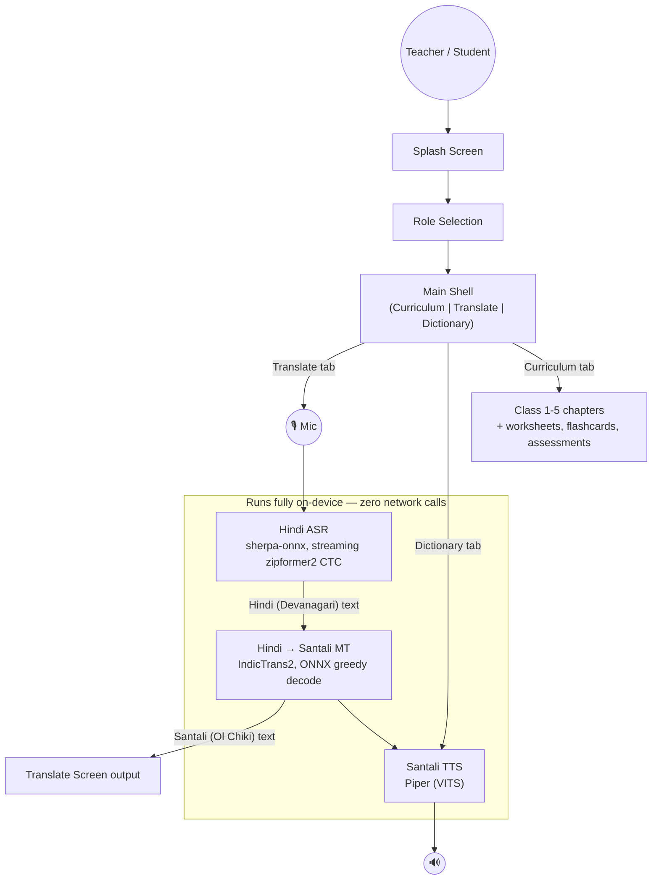

# VaaniSetu

**वाणी सेतु** — a voice bridge from Hindi to Santali (Ol Chiki), built for teachers and
students in Jharkhand government primary schools. Speak Hindi, get Santali — fully
**offline, on-device**, with a Class 1–5 curriculum browser and an offline dictionary
built in.

🔗 **Landing page:** [vaanisetu.lovable.app](https://vaanisetu.lovable.app/)

## Demo

<video src="https://raw.githubusercontent.com/samarthverma4/VaaniSetu/main/docs/0911.mp4" controls width="720">
  Your viewer doesn't render inline video — watch it directly:
  https://raw.githubusercontent.com/samarthverma4/VaaniSetu/main/docs/0911.mp4
</video>

📹 [Watch the demo video directly](https://raw.githubusercontent.com/samarthverma4/VaaniSetu/main/docs/0911.mp4)

## Why offline?

The schools this app is built for don't have reliable connectivity. Every piece of the
voice pipeline — speech recognition, translation, and text-to-speech — runs as a
bundled ONNX/Piper model on the device itself. No network call is ever made to
translate a sentence or synthesize speech.

## Architecture



All inference (the MT greedy-decode loop and both TTS voices) runs on a dedicated
background isolate, separate from the UI isolate and from the ASR's own isolate — on
the low-RAM tablets this targets, running ONNX inference on the UI thread froze the
app for the full duration of every translate/speak call.

## Features

- **Speech → Speech translation**: push-to-talk Hindi speech recognition, translated
  to Santali (Ol Chiki script) text and speech.
- **Curriculum browser**: the Jharkhand School Education Department's abridged Class
  1–5 syllabus, organized by class → subject → chapter, with worksheets, flashcards,
  and assessments per chapter.
- **Offline dictionary**: a searchable Hindi ↔ Santali phrase/word list with
  text-to-speech playback.
- **Teacher / Student roles**: the same app, scoped differently — teachers get
  worksheets and answer keys, students get flashcards and self-check quizzes.

## Tech stack

- **Flutter** (Dart) — UI, navigation, app shell
- **sherpa-onnx** — streaming Hindi ASR (zipformer2 CTC)
- **IndicTrans2 (ONNX, INT8)** — Hindi → Santali machine translation
- **Piper (VITS, ONNX)** — Hindi and Santali text-to-speech
- **onnxruntime** — on-device inference runtime for MT/TTS

## Getting started

```bash
flutter pub get                      # after any pubspec.yaml change
flutter run -d <device>              # Android is the only tested target
flutter analyze
flutter test
```

Model assets are Git LFS pointers — install `git-lfs` and run `git lfs pull` before
building, or the app will fail to load its models. See `CLAUDE.md` for full
architecture notes, known constraints, and the ASR bundle's own `HANDOFF.md`.
