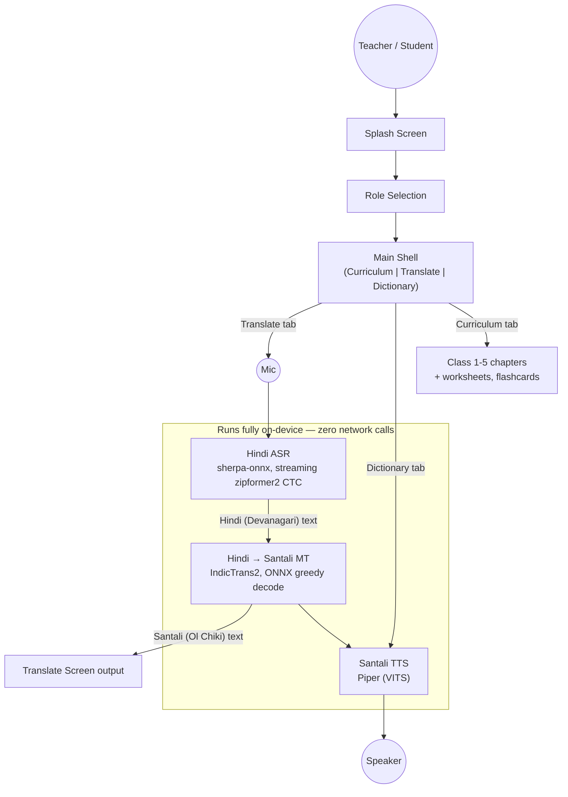

# VaaniSetu
 
**वाणी सेतु** — an offline, on-device voice bridge from Hindi to Santali (Ol Chiki),
built for teachers and students in Jharkhand government primary schools.
 
[](#)
[](#)
[](#)
[](#)
 
**Landing page:** [vaanisetu.lovable.app](https://vaanisetu.lovable.app/)
 
Built for **Smart India Hackathon 2026**, Problem Statement 26042 (Smart Education
track), by team **EKATRA**.
 
---
 
## Table of contents
 
- [Overview](#overview)
- [Problem statement](#problem-statement)
- [Demo](#demo)
- [Architecture](#architecture)
- [Features](#features)
- [How it works](#how-it-works)
- [Tech stack](#tech-stack)
- [Getting started](#getting-started)
- [Documentation](#documentation)
- [Contributing](#contributing)
- [License](#license)
- [Acknowledgments](#acknowledgments)
- [Author](#author)
## Overview
 
VaaniSetu lets a teacher speak a sentence in Hindi and get it back in Santali —
as Ol Chiki text and as spoken audio — without an internet connection. The entire
voice pipeline (speech recognition, translation, and speech synthesis) runs as
bundled ONNX/Piper models on the device itself. The app also ships a Class 1–5
curriculum browser and an offline Hindi–Santali dictionary, so it functions as a
classroom companion rather than a single-purpose translation tool.
 
## Problem statement
 
Santali-speaking students in Jharkhand's government primary schools are often
taught by teachers who are not fluent in Santali, and classroom materials are
predominantly in Hindi. Many of these schools also lack reliable internet
connectivity, which rules out any translation tool that depends on a network
call. VaaniSetu addresses both constraints at once: real-time Hindi–Santali
translation that runs entirely offline, paired with curriculum content the
teacher can use directly in the classroom.
 
## Demo
 
[](https://youtu.be/_iSc7zdFXjc)
 
**[Watch the demo on YouTube →](https://youtu.be/_iSc7zdFXjc)**
 
> The source recording is also tracked in-repo via Git LFS at `docs/0911.mp4`.
 
## Architecture
 

 
All inference — the MT greedy-decode loop and both TTS voices — runs on a
dedicated background isolate, separate from the UI isolate and from the ASR's
own isolate. On the low-RAM tablets this project targets, running ONNX
inference on the UI thread froze the app for the full duration of every
translate or speak call; isolating the work keeps the UI responsive during
inference, at the cost of some message-passing overhead between isolates.
 
## Features
 
| Feature | Description |
|---|---|
| **Speech-to-speech translation** | Push-to-talk Hindi speech recognition, translated to Santali (Ol Chiki script) as both text and synthesized audio — entirely on-device. |
| **Curriculum browser** | The Jharkhand School Education Department's abridged Class 1–5 syllabus, organized by class → subject → chapter, each with worksheets, flashcards, and assessments. |
| **Offline dictionary** | A searchable Hindi ↔ Santali phrase/word list with text-to-speech playback on any entry. |
| **Teacher / Student roles** | One app, scoped by role: teachers get worksheets and answer keys, students get flashcards and self-check quizzes. |
 
## How it works
 
1. **Splash Screen** — the app launches and loads its bundled models.
2. **Role Selection** — the user selects Teacher or Student, which scopes the
   Curriculum tab's content.
3. **Main Shell** — exposes three tabs: Curriculum, Translate, and Dictionary.
4. **Translate tab** — holding the mic streams audio into the on-device Hindi
   ASR (sherpa-onnx, streaming zipformer2 CTC), producing Devanagari text.
5. **Translation** — the Hindi text is passed to the Hindi → Santali MT model
   (IndicTrans2, INT8 ONNX, greedy decoding), producing Santali text in Ol Chiki
   script.
6. **Output** — the Santali text is displayed and simultaneously sent to the
   Santali Piper (VITS) voice for playback.
7. **Dictionary tab** — reuses the same Santali TTS voice for word and phrase
   lookups; the **Curriculum tab** serves Class 1–5 content independently of
   the voice pipeline.
## Tech stack
 
| Layer | Choice | Role |
|---|---|---|
| App shell / UI | Flutter (Dart) | Navigation, screens, state management |
| Speech recognition | sherpa-onnx (streaming zipformer2 CTC) | Hindi speech → Devanagari text |
| Machine translation | IndicTrans2 (ONNX, INT8, greedy decode) | Hindi text → Santali (Ol Chiki) text |
| Text-to-speech | Piper (VITS, ONNX) | Hindi and Santali speech synthesis |
| Inference runtime | onnxruntime | Runs MT and TTS models on-device |
 
## Getting started
 
### Prerequisites
 
- Flutter SDK
- An Android device or emulator (Android is the only tested target)
- [`git-lfs`](https://git-lfs.com/), for the bundled model assets
### Installation
 
```bash
git lfs install
git lfs pull                         # fetches the ONNX/Piper model assets
flutter pub get                      # after any pubspec.yaml change
```
 
### Running
 
```bash
flutter run -d <device>              # Android is the only tested target
```
 
### Testing
 
```bash
flutter analyze
flutter test
```
 
> Model assets are Git LFS pointers. Skipping `git lfs pull` will let the app
> build, but it will fail to load its models at runtime.
 
## Documentation
 
- `CLAUDE.md` — full architecture notes and known constraints.
- The ASR bundle's own `HANDOFF.md` — details specific to the sherpa-onnx
  integration.
## Contributing
 
Contributions, bug reports, and suggestions are welcome. Please open an issue
to discuss significant changes before submitting a pull request, and run
`flutter analyze` and `flutter test` before opening one.
 
## License
 
No license has been published for this project yet. Please contact the author
before reusing or redistributing any part of this codebase.
 
## Acknowledgments
 
- Curriculum content adapted from the Jharkhand School Education Department's
  Class 1–5 syllabus.
- Built on the open-source [sherpa-onnx](https://github.com/k2-fsa/sherpa-onnx),
  [IndicTrans2](https://github.com/AI4Bharat/IndicTrans2), and
  [Piper](https://github.com/rhasspy/piper) projects.
